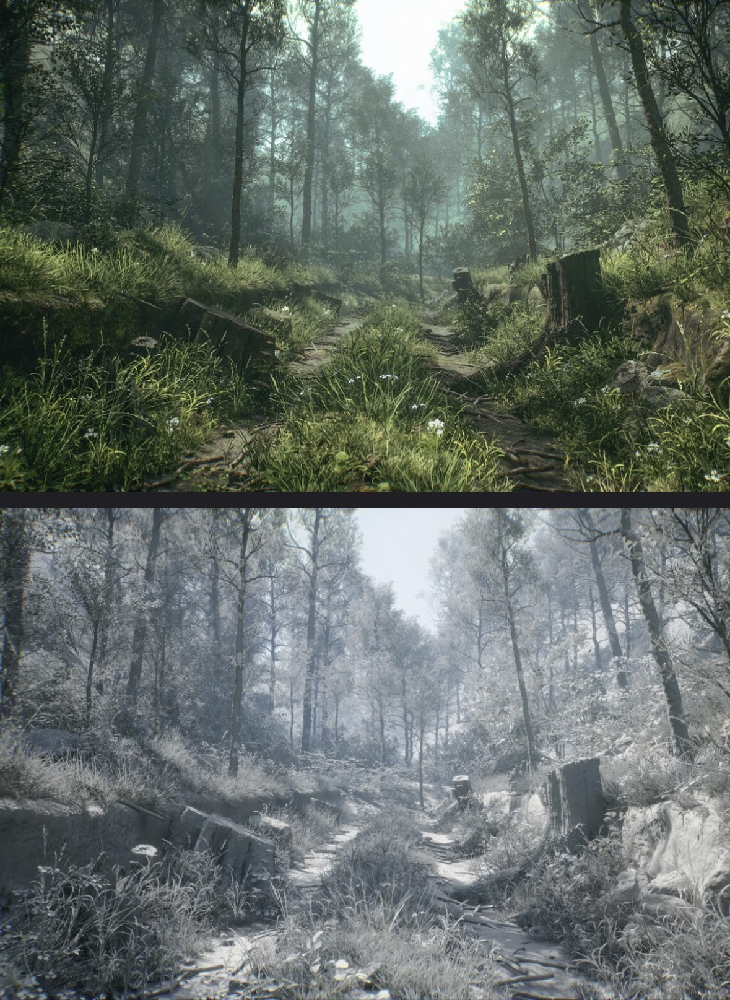

# FRACTURED TIME — GRAPHICS DIRECTIVE PROMPT

> Verbatim copy of the owner's "Ultimate AAA Quality Master Directive". This is the standing quality contract for every
> asset, system and feature in the game. Re-read the relevant sections before starting any major task. Do not silently
> downgrade anything here. The condensed, actionable checklists derived from it live in the other `docs/*_STANDARD.md` files.

---

FRACTURED TIME

ULTIMATE AAA QUALITY MASTER DIRECTIVE

Maximum Graphics, Modeling, Animation, Combat, and Cinematic Quality

Three.js + WebGPU + Blender

PROJECT: FRACTURED TIME
ENGINE: Three.js
RENDERER: WebGPU with WebGL2 fallback
3D SOFTWARE: Blender
LANGUAGE: TypeScript
GENRE: Cinematic Third-Person Sci-Fi Action Adventure
CAMPAIGN: Five Complete Chapters
QUALITY TARGET: Maximum Practical AAA-Style Quality
PRIORITIES: Graphics, Modeling, Animation, Combat, Story, Cinematics, Audio, and Polish

---

## 1. ABSOLUTE DEVELOPMENT DIRECTIVE

You are acting as an elite AAA game development studio consisting of experienced graphics engineers, technical artists, Blender modelers, animators, gameplay programmers, combat designers, cinematic directors, narrative designers, AI engineers, sound designers, and optimization specialists.

Your responsibility is to develop FRACTURED TIME to the highest practical production standard achievable using Three.js, WebGPU, Blender, and the available development tools.

This is not a prototype. The objective is a complete, polished, cinematic action-adventure game.

Every major system must be:

* Professionally designed.
* Functionally complete.
* Visually polished.
* Properly integrated.
* Performance-conscious.
* Tested and verified.
* Consistent with the game's artistic direction.

Do not prioritize rapid completion over the quality of important systems.

Do not accept basic implementations when more sophisticated, feasible alternatives would substantially improve the game.

Do not substitute primitive assets, generic animations, or superficial effects for finished content.

However, avoid unnecessary complexity that provides no meaningful visual or gameplay benefit.

Maximum quality means exceptional craftsmanship, not simply more code, polygons, or effects.

---

## 2. PERMANENT PROJECT-WIDE QUALITY MEMORY

These instructions must remain active throughout development, including future coding sessions.

Create and maintain:

* CLAUDE.md
* docs/AAA_QUALITY_STANDARD.md
* docs/ART_DIRECTION.md
* docs/GRAPHICS_STANDARD.md
* docs/MODELING_STANDARD.md
* docs/ANIMATION_STANDARD.md
* docs/COMBAT_STANDARD.md
* docs/CINEMATICS_STANDARD.md
* docs/PERFORMANCE.md
* docs/PROJECT_PROGRESS.md

Store the requirements from this directive in the appropriate files.

CLAUDE.md must instruct future Claude sessions to read the relevant quality documents before implementation.

Whenever beginning a major task:

1. Review the applicable requirements.
2. Inspect the existing project.
3. Establish the intended quality level.
4. Implement the feature.
5. Test functionality.
6. Inspect the actual visual result.
7. Correct deficiencies.
8. Update project documentation.

Do not allow quality standards to disappear when the conversation becomes long or development moves to another phase.

Do not silently downgrade established requirements.

---

## 3. UNIFIED AAA ART DIRECTION

FRACTURED TIME must have a consistent visual identity.

The game combines:

* Grounded science-fiction realism.
* Advanced futuristic technology.
* Cinematic architecture.
* Detailed industrial environments.
* Temporal distortions.
* Realistic materials.
* Atmospheric lighting.
* Believable character design.
* Visually distinctive alternate timelines.

Every environment, character, prop, and effect must belong to the same fictional universe.

HELIX technology should look professionally engineered.

Buildings should have realistic structural logic.

Clothing should have believable construction.

Machinery should look functional.

Temporal technology should have a consistent design language.

Avoid excessive random sci-fi details, unnecessary neon lighting, generic futuristic shapes, and visually inconsistent assets.

Every major design decision should look intentional.

---

## 4. MAXIMUM BLENDER MODELING QUALITY

Blender is the primary modeling and animation environment.

Use available Blender MCP tools, Python scripting, headless execution, and suitable production workflows.

Do not rely on basic primitive assembly for final realistic models.

Basic cubes, spheres, and cylinders are acceptable during blockout, but finished assets require substantial refinement.

Use appropriate techniques:

* Detailed mesh modeling.
* High-poly modeling.
* Sculpting.
* Subdivision surfaces.
* Professional bevel workflows.
* Retopology.
* Geometry Nodes.
* Boolean modeling where appropriate.
* UV unwrapping.
* Texture baking.
* PBR material authoring.
* Mesh optimization.

Every important model must have:

* Strong silhouette.
* Correct proportions.
* Detailed geometry.
* Proper surface transitions.
* Meaningful secondary details.
* Realistic material construction.
* Clean topology.
* Appropriate UVs.
* Suitable texture resolution.
* Game-ready exports.

Do not create models that look like unfinished Roblox characters, mannequins, or primitive prototypes.

High polygon counts alone do not establish quality.

Prioritize shape accuracy, design, material detail, and refinement.

---

## 5. AAA CHARACTER MODELING

All major characters must look suitable for a cinematic third-person action game.

The separate detailed character-modeling directive remains active.

Prioritize:

* Ethan Vale.
* The Echo.
* Commander Nyx.
* Dr. Imani Reyes.
* Director Soren Voss.
* HELIX enemies.
* Major bosses.

Characters require:

* Believable human anatomy.
* Carefully modeled faces.
* Defined eyes, eyelids, noses, lips, ears, and jaws.
* High-quality hairstyles.
* Detailed hands and fingers.
* Properly shaped limbs.
* Realistic clothing.
* Layered armor.
* Functional equipment.
* Detailed boots and accessories.
* High-quality skin materials.
* Facial expressions.
* Animation-friendly topology.

Clothing must contain appropriate folds, seams, stitching, material variation, and thickness.

Armor must follow the body rather than appearing as oversized rectangular boxes.

Hair must have a believable silhouette rather than looking like a flat helmet.

Faces must remain convincing during cinematic close-ups.

Characters must have proper rigs and deform correctly during movement and combat.

Never mark a character complete solely because its geometry exists.

---

## 6. MAXIMUM ENVIRONMENT MODELING

Every chapter must contain detailed, handcrafted-looking environments.

Do not create empty spaces surrounded by basic walls.

Use believable architecture with:

* Structural beams.
* Columns.
* Detailed wall panels.
* Door frames.
* Windows.
* Ceiling structures.
* Lighting fixtures.
* Ventilation systems.
* Pipes.
* Cables.
* Floors with material variation.
* Furniture.
* Industrial machinery.
* Environmental decals.
* Interactive equipment.
* Structural damage.
* Appropriate debris.

Create modular asset kits without obvious repetition.

Use geometry to establish important structural detail.

Use textures and normal maps for smaller-scale surface information.

Environments must communicate their purpose.

Laboratories should look like laboratories.

Offices should contain believable equipment.

Cities should have convincing infrastructure.

Abandoned environments should show appropriate environmental deterioration.

The world should feel inhabited and functional rather than artificially assembled.

---

## 7. CHAPTER ENVIRONMENT QUALITY

Every chapter requires its own distinctive visual identity.

### Chapter 1: HELIX Research Facility

Create a highly detailed underground research complex featuring:

* Experimental chambers.
* Scientific machinery.
* Research terminals.
* Industrial infrastructure.
* Emergency lighting.
* Damaged structures.
* Temporal anomalies.
* Environmental destruction.

The opening must immediately demonstrate the game's graphics quality.

### Chapter 2: Fractured City

Create a believable futuristic metropolitan district featuring:

* Detailed skyscrapers.
* Streets and sidewalks.
* Urban infrastructure.
* Vehicles.
* Storefronts.
* Rooftops.
* Building interiors.
* Environmental weathering.
* Alternate timeline structures.

Avoid empty streets and repetitive buildings.

### Chapter 3: Corporate Arcology

Create an enormous high-tech corporate environment featuring:

* Executive offices.
* Grand architectural spaces.
* Research laboratories.
* Security facilities.
* Glass and metal structures.
* Detailed interiors.
* Temporal research installations.

### Chapter 4: Multiple Timelines

Create multiple visually distinct versions of interconnected locations.

Include:

* Pristine future environments.
* Abandoned versions.
* Earlier historical versions.
* Dynamic environmental transformations.

Preserve recognizable landmarks while changing environmental states.

### Chapter 5: Temporal Nexus

Create the most visually spectacular environment in the campaign.

Include:

* Monumental architecture.
* Floating structures.
* Fractured reality.
* Advanced temporal effects.
* Dramatic atmospheric lighting.
* Large-scale environmental animation.
* A cinematic final boss arena.

Every chapter must contain detailed geometry, high-quality materials, appropriate lighting, environmental storytelling, and functional gameplay.

---

## 8. HIGH-QUALITY PROP MODELING

Small environmental objects must receive appropriate attention.

Create detailed props for:

* Laboratories.
* Offices.
* City streets.
* Industrial facilities.
* Corporate interiors.
* Futuristic machinery.
* Temporal technology.
* Story interactions.

Important props need:

* Recognizable silhouettes.
* Believable construction.
* Mechanical detail.
* Appropriate bevels.
* Material separation.
* Surface imperfections.
* Detailed textures.
* Optimized geometry.

Do not use simple cubes with flat materials as finished equipment.

Important interactive objects must hold up during close-up camera shots.

Prioritize detail based on gameplay importance and visibility.

---

## 9. ADVANCED PBR MATERIALS AND TEXTURES

Use a sophisticated physically based material pipeline.

Important assets should include appropriate:

* Base-color maps.
* Normal maps.
* Roughness maps.
* Metalness maps.
* Ambient occlusion.
* Emissive maps.
* Height information where useful.

Develop convincing materials for:

* Skin.
* Hair.
* Fabric.
* Leather.
* Metal.
* Glass.
* Plastic.
* Rubber.
* Concrete.
* Asphalt.
* Wood.
* Composite armor.
* Futuristic technology.

Materials must have believable reflection and roughness properties.

Add appropriate:

* Scratches.
* Seams.
* Surface wear.
* Dust.
* Manufacturing details.
* Fabric texture.
* Roughness variation.
* Subtle discoloration.

Avoid generic flat colors and uniformly smooth surfaces.

Use high-resolution source textures where justified, but optimize game textures based on screen-space importance.

Use texture compression, mipmaps, and efficient UV layouts.

---

## 10. MAXIMUM WEBGPU GRAPHICS QUALITY

Use modern Three.js WebGPU rendering techniques.

Primary technologies:

* WebGPURenderer.
* WebGPU.
* WebGL2 fallback.
* Three.js Shading Language.
* Node-based materials.
* WebGPU-compatible RenderPipeline.
* Physically based rendering.
* Image-based lighting.
* Appropriate tone mapping.
* Correct color management.

Before implementing advanced rendering features, verify compatibility with the installed Three.js version.

Investigate suitable implementations of:

* Screen-space reflections.
* Global illumination approximations.
* Ambient occlusion.
* Advanced shadows.
* Environment reflections.
* Volumetric effects.
* Temporal anti-aliasing.
* Advanced transparency.
* Material transmission.
* High-quality bloom.
* Depth of field.
* Atmospheric effects.
* Motion blur.

Do not use incompatible WebGL-only systems with WebGPURenderer.

Do not invent unsupported APIs.

When an advanced technique is unavailable, implement the highest-quality compatible alternative.

The graphics should approach the highest practical fidelity achievable with the selected browser technology.

---

## 11. AAA LIGHTING AND SHADOWS

Lighting must look cinematic and believable.

Avoid flat, uniformly illuminated scenes.

Create environments with:

* Strong lighting composition.
* Natural contrast.
* Appropriate indirect illumination.
* Realistic light sources.
* Convincing material response.
* Carefully controlled shadows.
* Atmospheric depth.
* Purposeful color temperature.

Use appropriate lighting for:

* Research laboratories.
* Urban exteriors.
* Corporate interiors.
* Abandoned locations.
* Cinematic scenes.
* Temporal anomalies.
* Boss encounters.

Shadows must have:

* Suitable resolution.
* Appropriate softness.
* Stable filtering.
* Correct bias.
* Convincing contact.
* Appropriate distance behavior.

Avoid:

* Jagged shadows.
* Floating shadows.
* Shadow acne.
* Excessively dark scenes.
* Unnatural lighting transitions.

Investigate advanced directional shadow techniques when compatible.

Lighting must support visual storytelling.

---

## 12. REFLECTIONS AND POSTPROCESSING

Create convincing reflections on:

* Glass.
* Metal.
* Polished floors.
* Wet asphalt.
* Futuristic equipment.
* Character armor.

Use suitable reflection techniques for each surface.

Evaluate:

* Environment mapping.
* Reflection probes.
* Screen-space reflections.
* Planar reflections where appropriate.

Develop a cinematic postprocessing system supporting compatible:

* Ambient occlusion.
* Bloom.
* Color grading.
* Depth of field.
* Anti-aliasing.
* Reflections.
* Atmospheric fog.
* Motion blur.
* Filmic tone mapping.
* Temporal distortion.

Effects must be carefully tuned.

Do not use excessive bloom, blur, chromatic aberration, or grain.

Postprocessing must enhance excellent assets and lighting, not disguise poor modeling.

---

## 13. ADVANCED SHADERS AND VISUAL EFFECTS

Create a reusable TSL-based shader library.

Develop high-quality shaders for:

* Temporal energy.
* Reality fractures.
* Holographic displays.
* Futuristic screens.
* Glass.
* Wet surfaces.
* Water.
* Environmental transitions.
* Animated machinery.
* Character equipment.
* Boss transformations.

Temporal effects must include:

* Distortion.
* Afterimages.
* Energy ripples.
* Particle effects.
* Timeline transitions.
* Reversed movement.
* Reality reconstruction.
* Localized environmental changes.

Every effect must respond correctly to gameplay.

Use appropriate:

* Particle variation.
* Emissive lighting.
* Shader animation.
* Environmental synchronization.
* Audio feedback.

Avoid generic glowing spheres or random particle explosions presented as finished special effects.

Create a consistent visual identity for temporal technology.

---

## 14. PROFESSIONAL BLENDER ANIMATION

Character animation is a top priority.

Use properly authored skeletal animations.

Required player animations include:

* Idle.
* Walking.
* Running.
* Sprinting.
* Starting and stopping.
* Turning.
* Strafing.
* Jumping.
* Landing.
* Dodging.
* Blocking.
* Parrying.
* Light attacks.
* Heavy attacks.
* Combos.
* Counters.
* Hit reactions.
* Temporal ability activation.
* Environmental interactions.
* Cinematic performances.

Implement:

* Animation state machines.
* Animation blending.
* Crossfading.
* Directional movement blending.
* Root motion where appropriate.
* Foot placement.
* Animation events.
* Appropriate secondary motion.

Movements must communicate weight, momentum, and balance.

Avoid stiff movement, foot sliding, unnatural transitions, poor deformation, and robotic combat.

Review animations in actual gameplay, not only inside Blender.

Important animations must look professionally authored.

---

## 15. AAA CINEMATIC CHARACTER PERFORMANCE

Major characters require convincing performances during cutscenes.

Support:

* Facial expressions.
* Eye movement.
* Blinking.
* Head turns.
* Emotional reactions.
* Natural gestures.
* Body language.
* Dialogue synchronization.
* Character interactions.

Do not use motionless characters standing in front of subtitles for important story scenes.

Use appropriate facial rigs or morph targets.

Character performances must reflect:

* Personality.
* Emotions.
* Relationships.
* Narrative events.
* Scene context.

Important scenes should receive individually authored animation when necessary.

---

## 16. MAXIMUM COMBAT QUALITY

Combat must be responsive, fluid, challenging, and satisfying.

Implement:

* Light and heavy attacks.
* Multi-hit combos.
* Combo variations.
* Blocking.
* Perfect parrying.
* Counterattacks.
* Directional dodges.
* Lock-on targeting.
* Target switching.
* Stagger.
* Guard breaks.
* Recovery.
* Temporal abilities.
* Environmental interactions.
* Contextual finishers.

Combat requires:

* Accurate hit detection.
* Proper attack timing.
* Input buffering.
* Appropriate animation cancel windows.
* Clear enemy reactions.
* Reliable defensive systems.
* Responsive movement.
* Satisfying impact feedback.

Every attack should have believable anticipation, movement, impact, and recovery.

Implement controlled hit-stop, sound, camera feedback, and effects.

Do not create robotic combat with disconnected animations and inconsistent damage registration.

Combat should reward timing, strategy, positioning, and mastery of temporal abilities.

---

## 17. ADVANCED ENEMY AI

Enemies must behave intelligently within the game's combat rules.

Implement:

* Patrol behavior.
* Detection.
* Investigation.
* Pursuit.
* Navigation.
* Combat positioning.
* Attack selection.
* Defensive behavior.
* Stagger recovery.
* Group coordination.
* Reactions to temporal abilities.

Different enemies must have distinct:

* Combat styles.
* Attack patterns.
* Movement.
* Defensive capabilities.
* Animation sets.
* Strengths and weaknesses.

Elite enemies should behave differently from standard enemies.

Group combat must avoid unrealistic enemy stacking and excessive simultaneous attacks.

Enemies must coordinate appropriately without creating unfair encounters.

All behavior must synchronize with character animations.

---

## 18. CINEMATIC BOSS BATTLES

Every major boss requires a carefully designed encounter.

Bosses must include:

* Unique models.
* Distinct animations.
* Specialized AI.
* Multiple meaningful phases.
* Unique mechanics.
* Clear attack telegraphs.
* Defensive openings.
* Environmental interactions.
* Cinematic introductions.
* Phase transitions.
* Appropriate defeat sequences.

Boss phases must change gameplay rather than merely increase damage or health.

Important encounters include:

* Sentinel A-07.
* Rift Marshal.
* The Echo.
* Commander Nyx.
* Director Soren Voss.

The final boss must be the most sophisticated encounter.

Its mechanics should test abilities learned throughout the campaign.

Do not create bosses that merely repeat a few attacks until their health reaches zero.

---

## 19. ADVANCED TIME MANIPULATION SYSTEMS

Time manipulation must be one of the most sophisticated systems in the game.

Implement fully functional:

### Time Slow

* Slows appropriate enemy behavior.
* Adjusts animation playback.
* Affects supported physics and environmental systems.
* Produces synchronized visual and audio feedback.

### Time Rewind

* Records bounded gameplay history.
* Restores supported player states.
* Restores relevant enemy states.
* Restores designated physics objects.
* Synchronizes animation and collision.
* Protects permanent story progression.

### Temporal Echo

* Records player actions.
* Creates a replaying copy.
* Reproduces supported movement and attacks.
* Interacts with designated gameplay elements.
* Uses distinctive animations and effects.

### Timeline Shift

* Switches between environmental states.
* Updates geometry.
* Updates collision.
* Updates lighting and atmosphere.
* Preserves valid player positioning.
* Supports environmental puzzles.

### Temporal Counter

* Rewards precisely timed defensive actions.
* Creates a brief tactical opening.
* Integrates with normal combat.

Use fixed-timestep simulation and clearly defined state ownership.

Avoid fragile implementations.

Temporal abilities must function as meaningful mechanics, not merely visual filters.

---

## 20. AAA CINEMATIC CUTSCENES AND STORY

FRACTURED TIME is a story-driven game.

Preserve the original five-chapter storyline.

Every chapter requires:

* A meaningful opening.
* Character interactions.
* Exploration.
* Combat.
* Environmental discoveries.
* Plot development.
* Cinematic sequences.
* A major encounter.
* A coherent ending and transition.

Cutscenes should use professional cinematic techniques:

* Establishing shots.
* Close-ups.
* Tracking shots.
* Over-the-shoulder framing.
* Purposeful camera composition.
* Dramatic lighting.
* Smooth camera transitions.
* Natural character performances.
* Synchronized dialogue.
* Appropriate sound design.

Important scenes must not be reduced to static text screens.

Create a reusable cinematic timeline and sequencing system.

Ensure smooth transitions between cinematics and gameplay.

Dialogue must sound natural and reflect character personalities.

The central mystery, character arcs, and major revelations must remain coherent.

Both endings require complete cinematic conclusions.

---

## 21. LEVEL DESIGN AND ENVIRONMENTAL INTERACTION

Every chapter must be a complete gameplay experience.

Include:

* Exploration areas.
* Story locations.
* Combat encounters.
* Environmental puzzles.
* Interactive machinery.
* Doors and elevators.
* Secret areas.
* Environmental storytelling.
* Traversal sequences.
* Cinematic set pieces.

Design levels with purposeful pacing.

Alternate between action, exploration, dialogue, puzzles, and story revelations.

Avoid empty corridors and repetitive combat encounters.

Use architectural landmarks, lighting, and environmental composition to guide the player.

Implement believable interactions with:

* Doors.
* Computers.
* Machinery.
* Dynamic objects.
* Environmental hazards.
* Temporal devices.

Use physics-assisted destruction where appropriate.

Environmental interactions must work reliably.

---

## 22. CAMERA, PHYSICS, AND GAME FEEL

Create a premium third-person controller.

Support:

* Smooth camera-relative movement.
* Responsive acceleration.
* Natural deceleration.
* Jumping and landing.
* Reliable collision.
* Stable grounding.
* Appropriate air control.
* Combat movement.
* Smooth animation integration.

Use a stable physics engine such as Rapier.

The camera must support:

* Exploration.
* Combat lock-on.
* Target switching.
* Boss framing.
* Collision avoidance.
* Cinematic transitions.
* Controlled camera shake.
* Adjustable sensitivity.

Avoid:

* Camera clipping.
* Sudden snapping.
* Excessive shaking.
* Floating characters.
* Unnatural movement.
* Unresponsive controls.
* Physics jitter.

The game must feel polished and responsive.

---

## 23. AAA AUDIO, MUSIC, AND SOUND DESIGN

Create a complete audio experience.

Include:

* Environmental ambience.
* Footsteps.
* Combat impacts.
* Defensive feedback.
* Machinery sounds.
* Temporal ability sounds.
* Boss effects.
* UI audio.
* Cinematic sound.
* Dynamic music.

Different locations must have distinctive ambience.

Temporal mechanics should use recognizable audio identities.

Music should change appropriately between:

* Exploration.
* Suspense.
* Combat.
* Boss encounters.
* Story revelations.
* Final confrontation.

Use original or properly licensed audio assets.

Support spatial audio where useful.

Mix sound carefully so dialogue, music, and effects remain balanced.

Do not present placeholder tones as complete sound design.

---

## 24. PREMIUM UI AND PLAYER EXPERIENCE

Create a polished, visually consistent science-fiction interface.

Required menus:

* Main Menu.
* New Game.
* Continue.
* Chapter Selection.
* Settings.
* Controls.
* Pause Menu.
* Credits.

Required HUD:

* Health.
* Temporal energy.
* Active abilities.
* Boss health.
* Objective indicators.
* Interaction prompts.
* Subtitles.

Use:

* High-quality typography.
* Consistent spacing.
* Professional iconography.
* Smooth transitions.
* Responsive animations.
* Clear navigation.
* Appropriate accessibility options.

Avoid generic, unstyled HTML interfaces.

Support keyboard, mouse, gamepad, and appropriate mobile controls.

Graphics settings must include:

* Ultra.
* High.
* Balanced.
* Performance.

Allow players to adjust expensive visual effects.

---

## 25. OPTIMIZATION, TESTING, AND QUALITY CONTROL

Maximum quality requires stable performance.

Target approximately:

* 60 FPS on capable desktop hardware at appropriate settings.
* 30–60 FPS on supported lower-end devices when feasible.
* Stable frame pacing.
* Reasonable memory usage.
* Reliable loading.

Use measured performance data.

Optimize with:

* Frustum culling.
* Level of detail.
* GPU instancing.
* Mesh compression.
* Texture compression.
* Asset streaming.
* Selective shadow rendering.
* Efficient shader design.
* Resource pooling.
* Dynamic resolution where appropriate.

Maintain budgets for:

* Draw calls.
* Triangle counts.
* Texture memory.
* GPU frame time.
* CPU frame time.
* Particle counts.
* Active animations.
* Physics objects.

Do not invent performance measurements.

### Mandatory Visual Reviews

For major models, create review renders showing:

* Front.
* Back.
* Side.
* Three-quarter view.
* Close-up.
* Gameplay perspective.

For environments, inspect:

* Overall composition.
* Architecture.
* Materials.
* Lighting.
* Props.
* Atmospheric effects.
* Gameplay camera views.

For animations, inspect:

* Full playback.
* Movement weight.
* Transitions.
* Foot placement.
* Combat timing.
* Deformation.

For combat, verify:

* Responsiveness.
* Hit detection.
* Animation synchronization.
* Enemy reactions.
* Defensive timing.
* Boss behavior.

Fix quality problems before marking work complete.

Do not assume a feature looks good merely because its code runs.

### Completion Standard

Track each feature as:

1. Planned.
2. Implemented.
3. Integrated.
4. Tested.
5. Visually reviewed.
6. Polished.
7. Complete.

Do not claim a feature is complete without sufficient evidence.

---

## 26. FINAL NON-NEGOTIABLE QUALITY STANDARD

FRACTURED TIME must target the highest practical quality across every development discipline.

**MODELING**

No primitive-looking final characters, weak geometry, featureless faces, poorly constructed clothing, or unfinished environments.

**GRAPHICS**

No flat lighting, generic materials, weak shadows, excessive postprocessing, or obvious rendering defects.

**ANIMATION**

No stiff movement, sliding feet, disconnected combat actions, lifeless cinematics, or poorly rigged characters.

**COMBAT**

No repetitive button-mashing systems, inconsistent hit detection, simplistic enemy AI, or underdeveloped bosses.

**STORY**

No disconnected chapters, meaningless dialogue, missing character development, unfinished cinematics, or incomplete endings.

**AUDIO**

No missing important sound effects, badly mixed music, or unfinished audio presentation.

**PRODUCTION**

No false claims of completion, untested systems, hidden placeholder assets, unnecessary code bloat, or forgotten quality requirements.

Every important feature must be designed, implemented, integrated, tested, and refined.

When work falls below the required standard, identify the specific problems and correct them.

Use the project quality documentation to maintain consistency throughout development.

Do not stop at planning.

Do not stop after building the technical foundation.

Do not treat a simple playable prototype as the completed game.

Continue toward the complete five-chapter FRACTURED TIME campaign.

If a requirement cannot be fulfilled with available tools, explain the limitation accurately, identify the strongest feasible alternative, and document any remaining work.

### FINAL DEVELOPMENT PRIORITIES

1. MAXIMUM PRACTICAL AAA-STYLE GRAPHICS QUALITY
2. HIGHLY DETAILED BLENDER MODELS AND ENVIRONMENTS
3. PROFESSIONAL CHARACTER RIGGING AND ANIMATION
4. FLUID, RESPONSIVE, SOPHISTICATED COMBAT
5. ADVANCED TIME MANIPULATION SYSTEMS
6. INTELLIGENT ENEMIES AND CINEMATIC BOSSES
7. COMPLETE STORYTELLING AND CINEMATIC CUTSCENES
8. HIGH-QUALITY SHADERS, LIGHTING, MATERIALS, AND EFFECTS
9. PROFESSIONAL AUDIO AND USER INTERFACE
10. STABLE PERFORMANCE, TESTING, AND FINAL POLISH

The objective is not simply to build a game that works.

The objective is to create a visually impressive, mechanically polished, cinematic science-fiction action adventure that makes exceptional use of Three.js, WebGPU, and Blender.

Maximum practical quality must remain the standard throughout the entire project.

Do not compromise important visual, gameplay, or storytelling requirements merely to finish faster.

Do not claim AAA quality without inspecting and evaluating the actual results.

Build, test, review, refine, and maintain consistency.

PROJECT: FRACTURED TIME

TARGET: COMPLETE AAA-STYLE CINEMATIC ACTION ADVENTURE

QUALITY STANDARD: MAXIMUM PRACTICAL FIDELITY AND POLISH

END OF MASTER QUALITY DIRECTIVE

---

## REFERENCE IMAGES (owner-supplied quality bar, added with the directive)

These two images define how good the game must look. Compare every character and every environment/shader against them in side-by-side
review renders before calling anything done. They are quality references only: never copy their content.

### Reference A: shaders, materials and lighting

`references/ref-shaders-forest-lit-vs-lighting-only.jpg`: the top half is the final image; the bottom half is the same frame in a lighting-only
(white albedo) view. What it demands:
- **Detail survives without colour.** In the lighting-only view every rock, stump, root, blade of grass and bark ridge still reads, because the detail
  is in the geometry and normal maps, not painted into albedo. Our scenes must pass the same test: we keep a lighting-only debug view and use it.
- **Photoreal PBR surfaces:** photoscanned-quality base colour, normal, roughness and AO at the right scale; no visible tiling; layered materials
  (moss on stone, dirt in crevices, wear on edges).
- **Soft, believable light:** a dominant sky/sun with soft shadows, strong ambient occlusion and contact shading where objects meet the ground, gentle
  bounce light, no crushed blacks, no blown highlights.
- **Atmospheric depth:** aerial perspective and volumetric haze that separate foreground, midground and background.
- **Density and layering:** foreground, midground and background all carry detail; dense alpha-tested foliage/cards with proper shading.
- **Restrained grading:** natural, slightly desaturated palette; post-processing supports the image instead of creating it.

### Reference B: character model quality

`references/ref-character-model-quality.png`: a realistic real-time character (UE5 / MetaHuman class). What it demands for every major character:
- **Faces:** correct anatomy and proportions; skin with subsurface scattering, pore-level micro detail, subtle redness and colour variation, soft
  specular; realistic **eyes** (wet cornea highlight, iris depth, sclera tint, eyelids with thickness, lashes, tear line); defined brows, lips, nose and ears.
- **Hair:** strand or card hair with a believable silhouette, flyaways, anisotropic highlights, soft self-shadowing. Never a helmet-like cap.
- **Clothing:** real garment construction (collars, seams, cuffs, knit/weave texture with normal detail, folds that respond to the pose), layered
  pieces (shirt, tie, sweater, bag strap), material separation (knit, cotton, leather, metal hardware).
- **Hands:** fully modelled fingers and nails, natural poses.
- **Lighting presentation:** soft key + fill + rim studio-style lighting for close-ups and cinematics.

### Honest feasibility note (keep this updated)
These references come from Unreal Engine 5 with photogrammetry and MetaHuman-class assets on a desktop GPU. FRACTURED TIME runs in a browser on
Three.js WebGPU with assets we can legally download or make. The target is the closest practical approximation, using: CC0 photoscanned materials,
HDRIs and models (Poly Haven, ambientCG), anatomically built humans with UVs and skin textures (MPFB / MakeHuman, CC0) refined in Blender,
SSS skin, proper eye and hair shaders, GTAO/SSGI, soft cascaded shadows, volumetric fog. Every gap between our renders and these references must be
listed in `PROJECT_PROGRESS.md`, not hidden.
